# Quản lý bãi giữ xe

Ứng dụng desktop Windows để hỗ trợ vận hành bãi xe: ghi nhận lượt xe vào/ra, quản lý thẻ xe và khách hàng, đăng ký vé tháng, cấu hình giá và xem báo cáo. Dự án được viết bằng C# Windows Forms, dùng SQL Server và tổ chức theo kiến trúc MVP nhiều tầng.

## Thành viên và đóng góp

| MSSV | Họ tên | Phần phụ trách | GitHub |
|---|---|---|---|
| 51.01.104.089 | Trần Chí Minh Tân | Thẻ xe, loại xe, bảng giá, tài khoản, CSDL | [@TranChiMinhTan](https://github.com/TranChiMinhTan) |
| 51.01.104.053 | Woòng Vĩnh Kiệt | Vận hành xe vào/ra, tính phí, in vé | [@KIỆTWV12](https://github.com/vongvinhkiet82-sudo) |
| 51.01.104.030 | Nguyễn Bảo Hoan | Khách hàng, vé tháng | [@hoansfsfs](https://github.com/hoansfsfs) |
| 51.01.104.019 | Nguyễn Hải Đăng | Báo cáo, thống kê, xuất CSV | [@dangdeptrai-quincyk](https://github.com/dangdeptrai-quincyk) |

---

## Báo cáo

- Bản PDF: [report/Quản_lý_bãi_giữ_xe.pdf](report/Quản_lý_bãi_giữ_xe.pdf)
- Mã nguồn LaTeX: [report/Quản_lý_bãi_giữ_xe.zip](report/Quản_lý_bãi_giữ_xe.zip)
- Phần trình bày: [report/Quản_lý_bãi_giữ_xe.pptx](report/Quản_lý_bãi_giữ_xe.pptx)

### Giao diện các chức năng

| Màn hình | Ảnh |
|---|---|
| Đăng nhập | 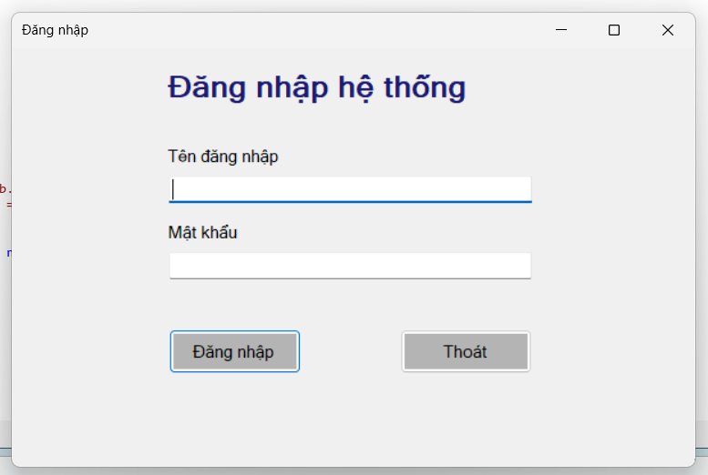 |
| Đổi mật khẩu | 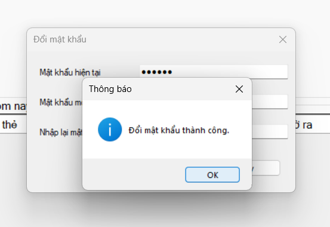 |
| Vận hành bãi xe | 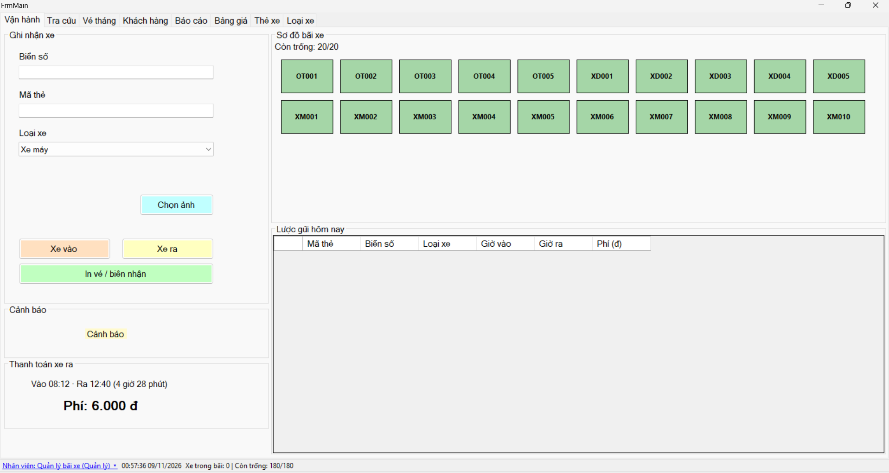 |
| Tra cứu lượt gửi | 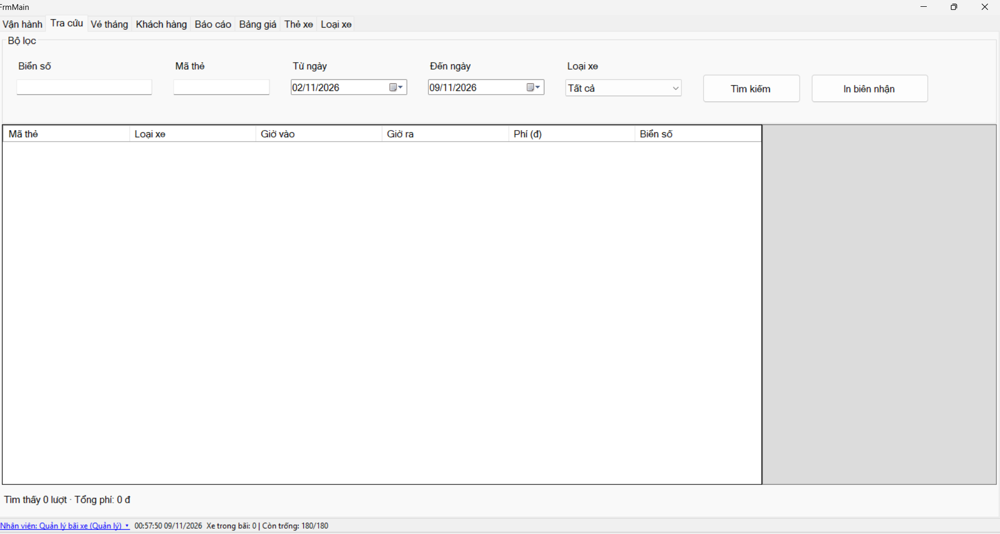 |
| Quản lý vé tháng | 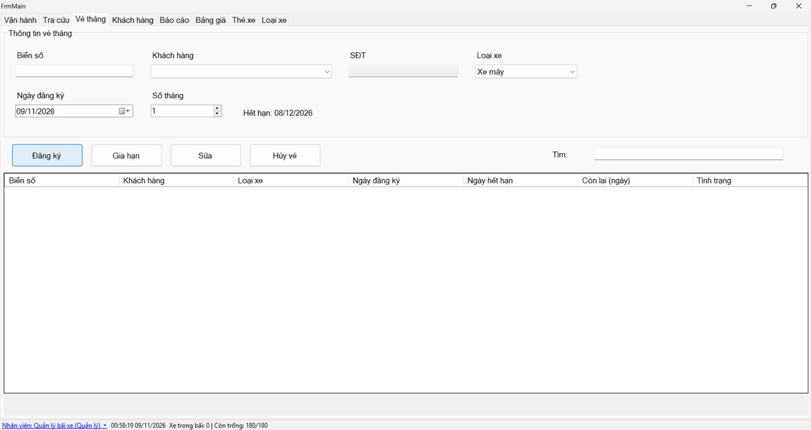 |
| Quản lý khách hàng | 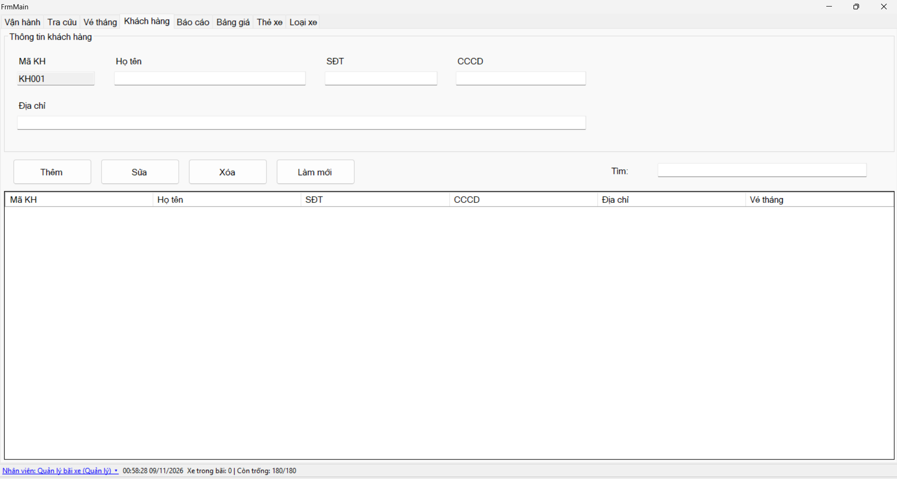 |
| Báo cáo doanh thu | 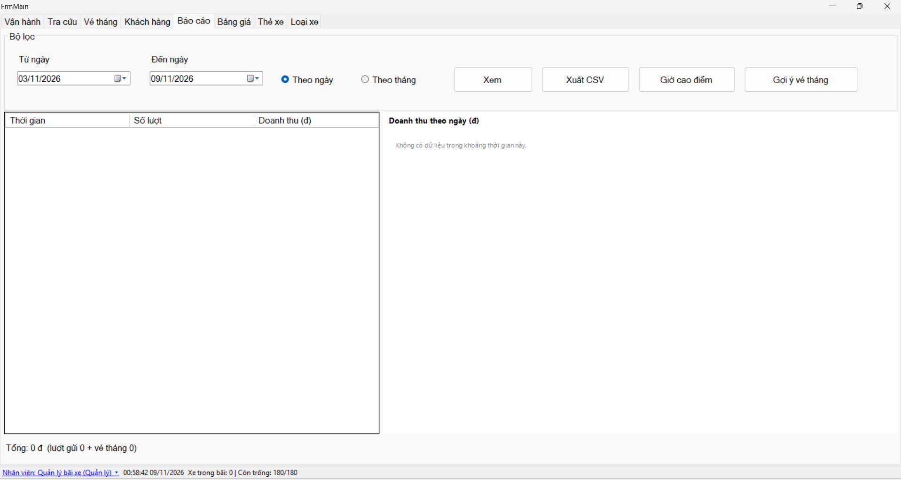 |
| Quản lý bảng giá | 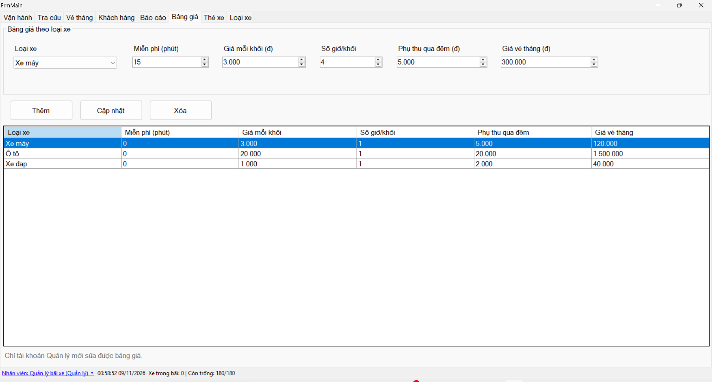 |
| Quản lý thẻ xe | 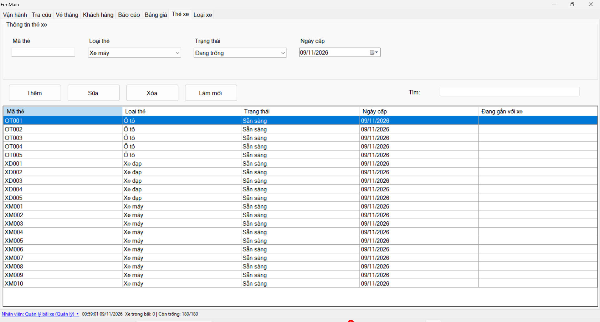 |
| Quản lý loại xe | 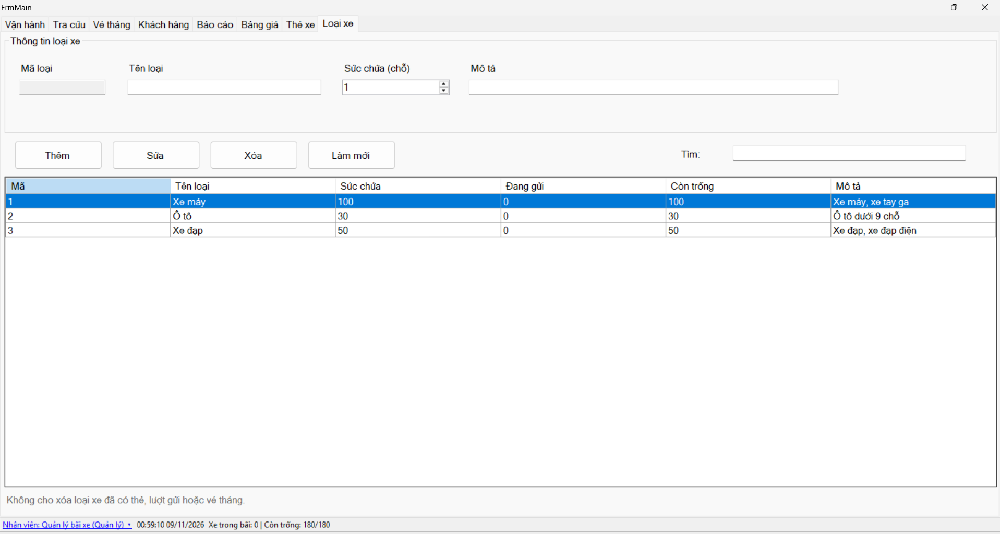 |
| Thống kê giờ cao điểm | 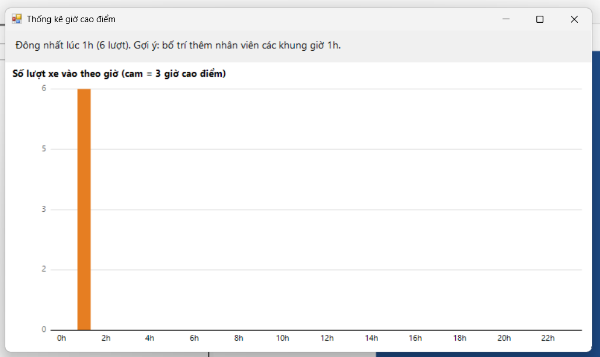 |

### Ảnh testcase và luồng thao tác

| Thao tác minh họa | Ảnh |
|---|---|
| Ghi nhận xe vào và xem sơ đồ bãi sau khi có xe | 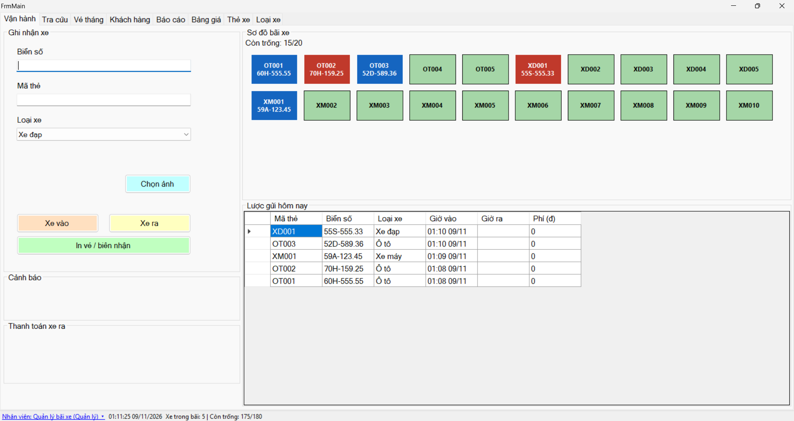 |
| Xem trước vé gửi xe | 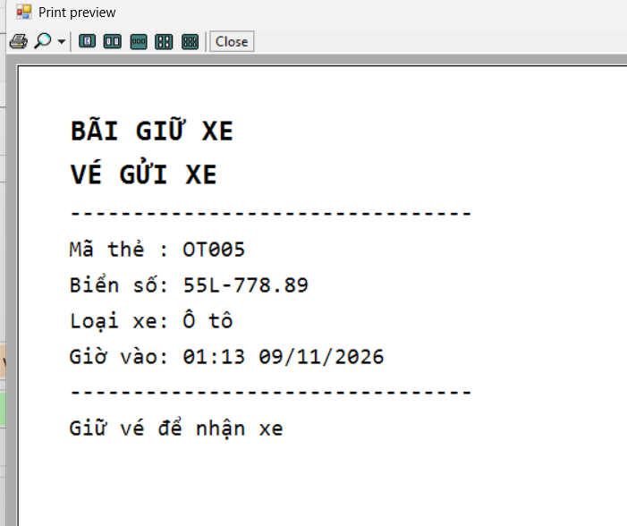 |
| Tra cứu lượt theo biển số | 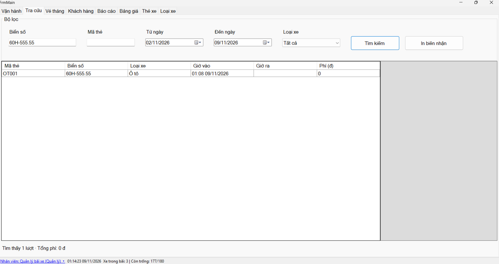 |
| Xem trước hóa đơn xe ra | 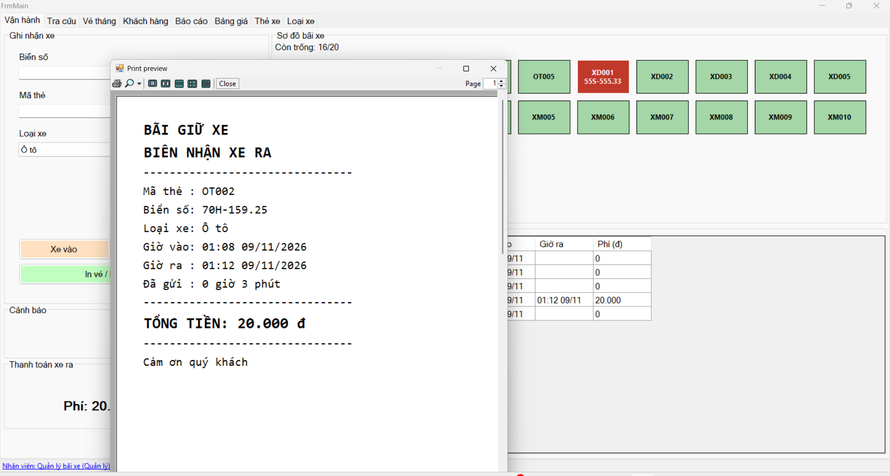 |
| Đăng ký vé tháng | 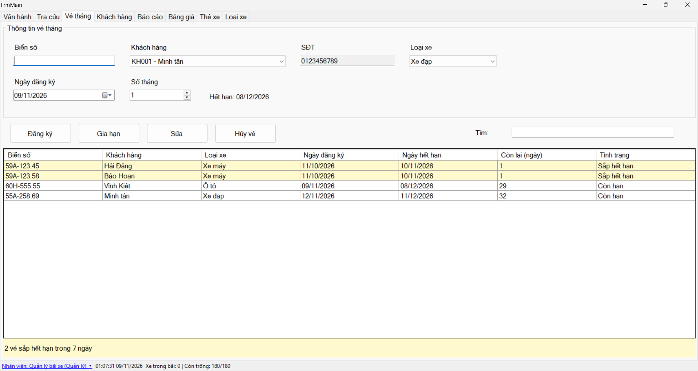 |
| Xem báo cáo doanh thu | 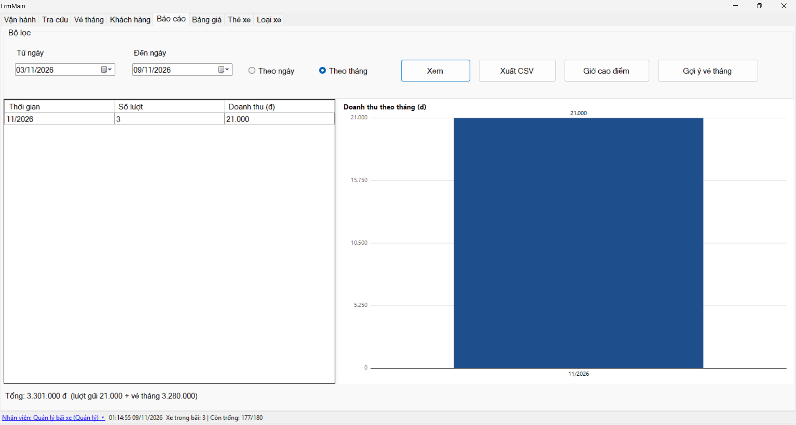 |
| Thêm khách hàng | 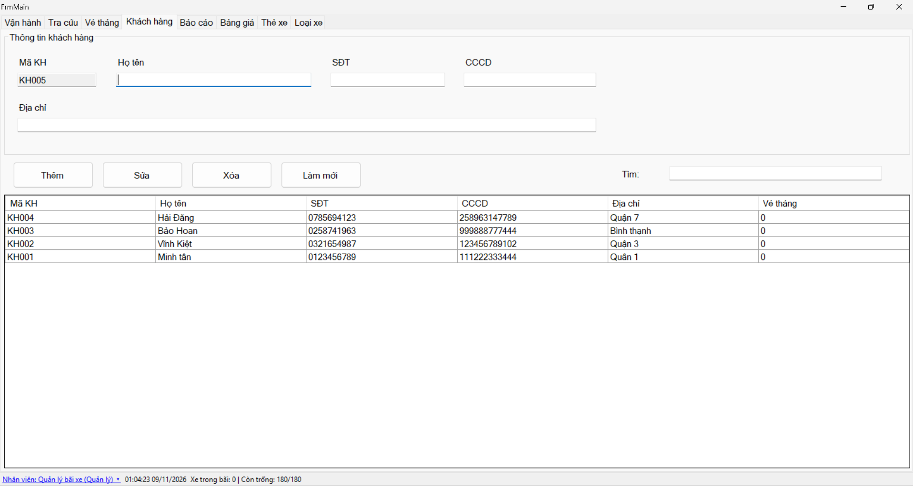 |

## Chức năng

- **Vận hành:** ghi nhận xe vào và xe ra theo biển số, mã thẻ và loại xe; theo dõi sơ đồ thẻ, số xe trong bãi và số chỗ còn trống; có thể chọn ảnh khi ghi nhận xe. Hỗ trợ xem trước vé gửi và biên nhận.
- **Tra cứu:** tìm thông tin lượt gửi để phục vụ tra cứu và thao tác in.
- **Vé tháng:** đăng ký, gia hạn, sửa và hủy vé; kiểm tra thời hạn sử dụng.
- **Khách hàng:** thêm, sửa, xóa và tìm kiếm thông tin khách hàng.
- **Danh mục:** quản lý bảng giá, loại xe và thẻ xe.
- **Báo cáo:** xem doanh thu theo ngày hoặc tháng, xuất CSV, xem thống kê giờ cao điểm và gợi ý biển số có thể phù hợp với vé tháng.
- **Tài khoản và quyền:** đăng nhập, đổi mật khẩu và đăng xuất. Nhân viên được hiển thị các màn vận hành, tra cứu, vé tháng và khách hàng; quản lý có thêm báo cáo và các màn danh mục. Nhật ký thao tác dành cho quản lý.

Các thao tác xe vào/ra và một số thao tác vé tháng sử dụng transaction ở tầng truy cập dữ liệu để giữ tính nhất quán khi ghi nhiều bản ghi liên quan.

## Kiến trúc

Ứng dụng tách giao diện, điều phối và nghiệp vụ thành các tầng:

```text
Views (Form/UserControl)
        ↕ interface
Presenters
        ↕
BLL (nghiệp vụ) ──→ DAL (ADO.NET/SQL) ──→ SQL Server
        ↕
     Models (DTO)
```

- **Views:** giao diện Windows Forms và các interface mô tả thao tác/hiển thị.
- **Presenters:** nhận sự kiện từ view, gọi nghiệp vụ và cập nhật giao diện.
- **BLL:** xử lý nghiệp vụ như kiểm tra dữ liệu, tính phí và vé tháng.
- **DAL:** kết nối SQL Server, thực thi truy vấn và stored procedure.
- **Models:** các DTO được dùng giữa các tầng.

## Công nghệ

- C# và Windows Forms trên **.NET Framework 4.8**.
- SQL Server, ADO.NET (`System.Data.SqlClient`).
- SQL script có bảng, dữ liệu khởi tạo và stored procedure; ứng dụng dùng transaction cho các thao tác cần ghi đồng bộ.

## Cấu trúc repository

```text
.
├── BLL/                    # Nghiệp vụ
├── DAL/                    # Truy cập SQL Server
├── Database/
│   └── Database.sql
├── docs/
│   ├── erd.png
│   └── images/             # Ảnh giao diện và testcase
├── Models/                 # DTO
├── Presenters/             # Điều phối giữa View và BLL
├── Properties/             # Resources và settings
├── README.md
├── report/
│   ├── chapters/           # Các chương báo cáo LaTeX
│   ├── images/
│   ├── main.tex
│   └── References.bib
├── Views/                  # Form, UserControl và interface giao diện
└── Root/
    ├── App.config          # Chuỗi kết nối SQL Server
    ├── Program.cs          # Điểm khởi chạy ứng dụng
    ├── QUanLyBaiGiuXe.slnx
    └── QuanLyBaiGiuXe.csproj
```

## Cài đặt và chạy

### Yêu cầu

- Windows.
- Visual Studio có workload **.NET desktop development** và targeting pack **.NET Framework 4.8**.
- SQL Server (có thể dùng SQL Server Express) và công cụ quản lý SQL Server như SSMS.

### Các bước

1. Clone repository:

   ```bash
   git clone https://github.com/TranChiMinhTan/QuanLyBaiGiuXe.git
   cd QuanLyBaiGiuXe
   ```

2. Tạo cơ sở dữ liệu: mở `Database/Database.sql` trong SSMS và thực thi trên SQL Server. **Cảnh báo:** script kiểm tra rồi xóa database `QuanLyBaiGiuXe` hiện có trước khi tạo lại, do đó mọi dữ liệu trong database đó sẽ mất. Đóng ứng dụng trước khi chạy script.

3. Cấu hình chuỗi kết nối trong `App.config`. Mặc định dự án dùng xác thực Windows và SQL Server instance mặc định:

   ```xml
   <add name="QuanLyBaiGiuXeDB"
        connectionString="Server=.;Database=QuanLyBaiGiuXe;Trusted_Connection=True;TrustServerCertificate=True;"
        providerName="System.Data.SqlClient" />
   ```

   Nếu dùng SQL Server Express hoặc instance khác, thay `Server=.` bằng tên instance phù hợp trên máy của bạn. Giữ tên database là `QuanLyBaiGiuXe`, trừ khi đồng thời cập nhật script và cấu hình ứng dụng.

4. Mở `QUanLyBaiGiuXe.slnx` hoặc trực tiếp `QuanLyBaiGiuXe.csproj` trong Visual Studio, build và chạy ứng dụng.

### Dữ liệu khởi tạo

`Database/Database.sql` tạo các loại xe Xe máy, Ô tô, Xe đạp; giá ban đầu và 20 thẻ xe. Script cũng tạo hai tài khoản để đăng nhập thử:

| Tên đăng nhập | Mật khẩu | Vai trò |
|---|---|---|
| `admin` | `123456` | Quản lý |
| `nv01` | `123456` | Nhân viên |

Đây là thông tin được khai báo trong script tạo database, không phải tài khoản cho môi trường triển khai thực tế.

## Hướng dẫn sử dụng nhanh

1. Khởi chạy ứng dụng và đăng nhập bằng tài khoản đã tạo trong database.
2. Ở tab **Vận hành**, nhập biển số, mã thẻ, chọn loại xe tương ứng và dùng **Xe vào** để ghi nhận lượt gửi.
3. Khi xe rời bãi, nhập mã thẻ hoặc chọn thẻ đang có xe trên sơ đồ để điền mã, rồi bấm **Xe ra**. Xem phí tạm tính và xác nhận thanh toán; có thể in biên nhận sau khi thanh toán thành công.
4. Dùng các tab **Tra cứu**, **Vé tháng** và **Khách hàng** để tra cứu hoặc quản lý dữ liệu. Quản lý có thể mở **Báo cáo** để xem doanh thu, xuất CSV hoặc mở thống kê giờ cao điểm và gợi ý vé tháng.

## 👥 Thành viên và đóng góp

| MSSV | Họ tên | Phần phụ trách | GitHub |
|---|---|---|---|
| 51.01.104.089 | Trần Chí Minh Tân | Thẻ xe, loại xe, bảng giá, tài khoản, CSDL | [@TranChiMinhTan](https://github.com/TranChiMinhTan) |
| 51.01.104.053 | Woòng Vĩnh Kiệt | Vận hành xe vào/ra, tính phí, in vé | [@KIỆTWV12](https://github.com/vongvinhkiet82-sudo) |
| 51.01.104.030 | Nguyễn Bảo Hoan | Khách hàng, vé tháng | [@hoansfsfs](https://github.com/hoansfsfs) |
| 51.01.104.019 | Nguyễn Hải Đăng | Báo cáo, thống kê, xuất CSV | [@dangdeptrai-quincyk](https://github.com/dangdeptrai-quincyk) |

---

## 📚 Báo cáo

- Bản PDF: [report/BaoCao.pdf](report/BaoCao.pdf)
- Mã nguồn LaTeX: [report/BaoCao_latex.zip](report/BaoCao_latex.zip)